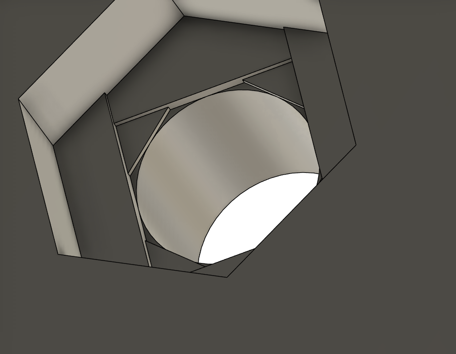

# Sequential Bridge for Autodesk Fusion


A Fusion add-in that adds **sequential bridging** to a hole, so a hole that starts in mid-air
(above a nut pocket, counterbore or any other recess) 3D prints cleanly **without supports**.

You pick one face, choose how many bridge layers you want, and the add-in builds the
geometry for you as ordinary timeline features.

The technique is the one shown by Maker's Muse in
[How to 3D Print bores without supports](https://www.youtube.com/watch?v=KBuWcT8XkhA&t=397s).

## What it does

When a part is printed pocket-down, the first layer above the pocket has nothing under it
where the smaller hole begins. A round hole cannot be bridged, but straight lines can.
Sequential bridging replaces the round opening with shapes made of straight bridges, one
layer at a time:

| Layer | Opening left in that layer | Why it prints |
|-------|----------------------------|---------------|
| 1 | A slot as wide as the hole, across the whole pocket | Two straight bridges from pocket wall to pocket wall |
| 2 | A square around the hole | Two short bridges resting on the layer-1 bridges |
| 3 | An octagon | Four corner bridges resting on the square |
| 4, 5 | 16 and 32 sides | Each new edge rests on the layer before |
| after | The round hole | Only tiny overhangs are left |

Two layers are enough for small holes (an M6 bolt hole, for example). Use three or more for
larger holes.

| Cut, 3 bridges, rectangular pocket | Add, 3 bridges, hex pocket |
|---|---|
|  |  |

Both pictures look up into the pocket from the print bed side.

## Install

1. Download this repository (**Code > Download ZIP**) and unzip it, or clone it.
2. In Fusion open **Utilities > Add-Ins > Scripts and Add-Ins** (or press **Shift+S**).
3. Click **+**, choose **Script or add-in from device**, and select the `SequentialBridge`
   folder (the one that contains `SequentialBridge.manifest`).
4. Turn on **Run** for SequentialBridge. Tick **Run on Startup** if you want it loaded every time.

The command appears in the Design workspace under **Solid > Modify > Sequential Bridge**.
You can also press **S** and search for "Sequential Bridge".

## Use

1. Start **Sequential Bridge**.
2. Select the flat face that the hole goes through: the "ceiling" of the pocket, the face
   that would be unsupported when printing. Only flat faces with a round hole can be picked.
3. Adjust the settings. The preview updates as you change them.
4. Click **OK**.

### Settings

| Setting | Default | Meaning |
|---------|---------|---------|
| **Face** | | The flat face with the round hole. |
| **Bridges** | 2 | Number of bridge layers, 1 to 5. |
| **Layer height** | 0.2 mm | Thickness of each bridge layer. Must match the layer height you slice with. |
| **Operation** | Cut | **Cut** removes the layers from the solid behind the face, so the pocket keeps its depth and the hole gets shorter by *bridges x layer height*. **Add** builds the layers in front of the face, so the hole keeps its length and the pocket gets shallower by the same amount. |
| **Rotate bridges** | 0 deg | Turns the direction of the first bridges. At 0 the add-in chooses the direction itself. |

### How the bridge direction is chosen

The first bridges should be as short as possible. The add-in looks at the outline of the
selected face:

- If the pocket has straight walls, it tries the directions along and across each wall and
  keeps the one with the shortest bridges. Bridges always stay parallel or square to a wall.
- If the pocket is round, every direction is equal and it uses the face's own X direction.

Use **Rotate bridges** (for example 90 deg) if you want a different direction.

### Result in the timeline

Each run adds one group named **Sequential Bridge** containing sketches, extrudes and one
combine. To remove the bridges, delete that group. To change them, delete the group and run
the command again.

## Printing notes

- **Layer height must match the slicer.** The bridges only work if each modelled layer is
  exactly one printed layer.
- **The face should land on a layer boundary.** If the pocket depth is not a multiple of the
  layer height, the slicer will round it and the bridge layers may merge or split.
- Print with the pocket facing the bed, as in the pictures above.

## Limits

- Round holes only. Slots and other shapes are ignored. Several round holes in one face are
  handled together in a single run.
- The bridge outlines are fixed when the command runs. If you later move or resize the hole,
  delete the timeline group and run the command again.
- With **Cut**, a hole that sits closer to a pocket wall than its own radius is still handled,
  but the bridge layers are trimmed at the wall.

## Troubleshooting

- **The command is missing from the Modify menu:** the add-in is not running. Open
  Scripts and Add-Ins (Shift+S) and turn on **Run** for SequentialBridge.
- **A face cannot be selected:** it is not flat or has no round hole in it.
- **Something failed:** errors are written to `SequentialBridge.log` in your temp folder
  (`%TEMP%` on Windows, `$TMPDIR` on macOS).

## Repository layout

| Path | Contents |
|------|----------|
| `SequentialBridge/SequentialBridge.py` | The command: dialog, face analysis, feature creation. |
| `SequentialBridge/bridge_geometry.py` | The 2D geometry (layer outlines, bridge direction). No Fusion imports. |
| `SequentialBridge/selftest.py` | Developer self-test that runs inside Fusion. |
| `SequentialBridge/resources/` | Toolbar icons. |
| `tests/` | Unit tests for the geometry. |
| `tools/make_icon.py` | Script that draws the icons. |

## Development

The geometry has no Fusion dependency and can be tested with plain Python:

```
python -m unittest discover -s tests
```

To test the feature creation inside Fusion, start Fusion with the environment variable
`SEQ_BRIDGE_SELFTEST` set to an output folder and the add-in set to run on startup. It
builds eight sample parts in a new document, runs every mode on them, compares the volume
change with hand-calculated values, and writes `selftest_result.json` plus screenshots to
that folder. The self-test never runs without that variable.

To regenerate the icons (requires Pillow):

```
python tools/make_icon.py SequentialBridge/resources
```

Tested on Windows with Fusion 2706.1.17.
